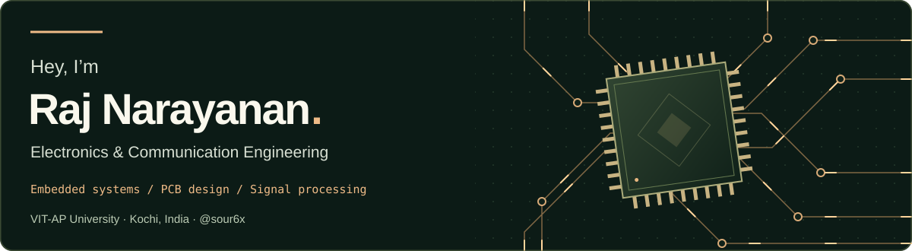

  

  <a href="https://sour-portfolio.vercel.app/"><strong>Portfolio</strong></a>
  &nbsp; / &nbsp;
  <a href="https://www.linkedin.com/in/raj-narayanan-900650251/"><strong>LinkedIn</strong></a>
  &nbsp; / &nbsp;
  <a href="mailto:vrajnarayan666@gmail.com"><strong>Email</strong></a>
  &nbsp; / &nbsp;
  <a href="https://sour-portfolio.vercel.app/V-Raj-Narayanan-Resume.pdf"><strong>Resume</strong></a>

  <a href="#my-projects">Projects</a> · <a href="#engineering-toolkit">Toolkit</a> · <a href="#education--coursework">Education</a> · <a href="#certifications--training">Training</a> · <a href="#lets-make-a-connection">Contact</a>

## About me

I’m **V Raj Narayanan**, a final-year **Electronics and Communication Engineering** undergraduate at **VIT-AP University**. I work across embedded systems, PCB design, analog electronics, and signal processing, with an interest in bringing hardware and software together.

I enjoy the complete process: understanding a signal, designing the circuit around it, laying out a board, and writing the firmware that connects it to the rest of a system. My projects explore measurement hardware, assistive wearables, automation, and audio electronics.

- **Based in:** Kochi, Kerala, India
- **Education:** B.Tech, Electronics & Communication Engineering · VIT-AP · 2023–2027
- **Technical interests:** mixed-signal acquisition, embedded control, analog front ends, and embedded audio

## My projects

Click a preview to open its repository, or expand a project to see how it works.

[SPECTER](#specter) · [OCR assistive glasses](#ocr-assistive-glasses) · [Smart fire suppression system](#smart-fire-suppression-system) · [Digital pitch-shift pedal](#digital-pitch-shift-pedal) · [Smart railway safety system](#smart-railway-safety-system) · [Acousta](#acousta)

### SPECTER

**Four-layer measurement & acquisition PCB**

A **four-layer measurement PCB** for a prototype robotic PCB diagnostic instrument. Programmable-gain voltage, current, and impedance-related signal paths connect to a shared differential ADC, with an STM32H743 coordinating acquisition.

**Stack:** `STM32H743` `AD4003` `KiCad` `Analog electronics`

<strong>Explore the board architecture</strong>

- **Acquisition:** AD4003 ADC and ADA4945-1 differential driver
- **Front ends:** LTC6910 programmable-gain stages and signal conditioning
- **Integration:** channel selection, reference circuitry, and power distribution
- **Artifact:** four-layer board design and 3D render

**[Explore repository](https://github.com/sour6x/SPECTER-Measurement-PCB)** · [View image](https://github.com/sour6x/SPECTER-Measurement-PCB/blob/main/Images/3D-view.png)

### OCR assistive glasses

**A wearable exploration of accessible electronics**

A **team-built wearable prototype** that streams ESP32-CAM video over Wi-Fi to a computer for text recognition, Hindi translation, and speech playback. It connects camera interfacing and computer vision with accessible interaction.

**Stack:** `ESP32-CAM` `Python` `OpenCV` `PaddleOCR`

<strong>Follow the recognition pipeline</strong>

1. Capture video with the ESP32-CAM.
2. Stream frames to a computer over Wi-Fi.
3. Recognize text, translate it into Hindi, and generate speech.

The computer handles the recognition and speech processing; this is a wearable prototype.

**[Explore repository](https://github.com/sour6x/OCR-Assistive-Glasses)** · [View image](https://github.com/sour6x/OCR-Assistive-Glasses/blob/main/Images/demonstration.jpeg)

### Smart fire suppression system

**Sensing, positioning, and embedded control**

An **educational Arduino and ESP32 prototype** that scans for a flame, positions a water nozzle, operates a relay-controlled pump, and displays status over local Wi-Fi. It brings sensing, servo control, and serial communication into one demonstration.

**Stack:** `Arduino` `ESP32` `Embedded C/C++` `Servo control`

<strong>See how the prototype responds</strong>

- Sense a flame and position the nozzle.
- Control the water pump through a relay.
- Report system status through a local Wi-Fi interface.

Educational demonstration; not a certified fire protection system.

**[Explore repository](https://github.com/sour6x/Smart-Fire-Suppression-System)** · [View image](https://github.com/sour6x/Smart-Fire-Suppression-System/blob/main/Images/project.jpeg)

### Digital pitch-shift pedal

**An experiment in embedded sound**

A **custom two-layer guitar-effects PCB** designed around an ESP32-S3 and WM8960 audio codec. Analog input buffering, an OLED interface, and semitone controls support an exploration of digital pitch shifting.

**Stack:** `ESP32-S3` `WM8960` `OPA1652` `KiCad`

<strong>Look inside the audio hardware</strong>

- **Audio:** WM8960 codec and analog input buffering
- **Processing platform:** ESP32-S3
- **Controls:** OLED interface and semitone selection
- **Artifact:** custom two-layer PCB design

**[Explore repository](https://github.com/sour6x/Pitch-Shift-Pedal)** · [View image](https://github.com/sour6x/Pitch-Shift-Pedal/blob/main/Images/3D_Render.jpeg)

### Smart railway safety system

**Obstacle detection on a model vehicle**

A **team-built model-scale prototype** exploring obstacle detection and an automatic stop response. An Arduino Uno reads an HC-SR04 ultrasonic sensor, with LED indication and a transmitted stop signal described in the project report.

**Stack:** `Arduino Uno` `HC-SR04` `Motor control` `Prototyping`

<strong>Explore the sensing and response</strong>

- **Input:** ultrasonic distance sensing
- **Response:** motor stop, LED indication, and a transmitted stop signal
- **Documentation:** prototype photograph and original project report

Educational model-scale prototype; not a validated railway safety system.

**[Explore repository](https://github.com/sour6x/Smart-Railway-Safety-System)** · [View image](https://github.com/sour6x/Smart-Railway-Safety-System/blob/main/Images/prototype.jpeg)

### Acousta

**Guitar practice for your own songs · formerly Fretwise**

A **guitar practice studio** that estimates chords, key, and tempo from audio. Practice with waveform playback, A/B loops, chord editing, transposition, capo guidance, and fretboard scales.

**Stack:** `Next.js` `TypeScript` `FastAPI` `librosa`

<strong>Explore the practice tools and audio pipeline</strong>

- **Player:** WaveSurfer.js waveform, seeking, playback speed, and practice loops
- **Guitar tools:** editable chord timeline, capo shapes, transposition, and scale exploration
- **Analysis:** Python service using librosa and NumPy

Analysis uses heuristic estimates, so chord labels and timestamps can be corrected manually. Transposition changes the displayed chords, not the audio pitch.

**[Explore repository](https://github.com/sour6x/Acousta)** · [View image](https://github.com/sour6x/Acousta/blob/main/public/acousta-logo.png) · **[Try the live app](https://acousta-mu.vercel.app/)**

## Engineering toolkit

| Area | Technologies & tools |
| :--- | :--- |
| **Programming** | C, C++, Embedded C, Python, Java |
| **Microcontrollers & computing** | STM32, ESP32, Arduino, Raspberry Pi |
| **Hardware design** | KiCad, PCB layout, circuit design, analog electronics, signal conditioning |
| **Interfaces** | UART, SPI, I²C |
| **Embedded development** | Keil µVision, Arduino IDE |
| **Signal processing** | MATLAB, audio electronics, embedded DSP |
| **Web & audio apps** | React, Next.js, TypeScript, FastAPI, librosa |
| **Computer vision** | OpenCV, PaddleOCR |

## Education & coursework

**VIT-AP University**  
B.Tech in Electronics and Communication Engineering · **2023–2027**

Relevant coursework:

`Digital Electronics` · `Microprocessors & Microcontrollers` · `Analog Electronics` · `Signals & Systems` · `Embedded Systems`

<strong>Earlier education</strong>

**Rajagiri Christu Jayanthi Public School**  
Senior Secondary · CBSE · 2023

## Experience & involvement

**Maven Silicon — Embedded hardware system design internship**  
Practical technical training in embedded systems and semiconductor design workflows.

**IETE, VIT-AP — Technical member**  
Contributed to technical workshops, electronics activities, and hardware-oriented student projects.

## Certifications & training

| Embedded & hardware | Software & emerging technologies |
| :--- | :--- |
| Maven Silicon Internship | AWS Academy Cloud Foundations |
| STM32F4 Embedded Development | MATLAB Programming |
| Embedded C Programming | NVIDIA LLM Applications |

<strong>Languages</strong>

English · Malayalam · Hindi · Tamil · Spanish

## Let’s make a connection

For opportunities, collaborations, or a conversation about electronics, get in touch.

**[Portfolio](https://sour-portfolio.vercel.app/)** · **[LinkedIn](https://www.linkedin.com/in/raj-narayanan-900650251/)** · **[vrajnarayan666@gmail.com](mailto:vrajnarayan666@gmail.com)**

[Back to top ↑](#top)
