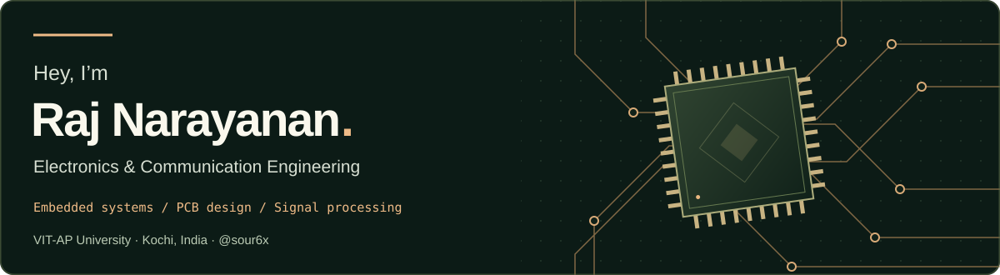

  

  <a href="https://sour6x.github.io/Portfolio/"><strong>Portfolio</strong></a>
  &nbsp; / &nbsp;
  <a href="https://www.linkedin.com/in/raj-narayanan-900650251/"><strong>LinkedIn</strong></a>
  &nbsp; / &nbsp;
  <a href="mailto:vrajnarayan666@gmail.com"><strong>Email</strong></a>
  &nbsp; / &nbsp;
  <a href="https://sour6x.github.io/Portfolio/V-Raj-Narayanan-Resume.pdf"><strong>Resume</strong></a>

## About me

I’m **V Raj Narayanan**, a final-year **Electronics and Communication Engineering** undergraduate at **VIT-AP University**. I work across embedded systems, PCB design, analog electronics, and signal processing, with an interest in bringing hardware and software together.

I enjoy the complete process: understanding a signal, designing the circuit around it, laying out a board, and writing the firmware that connects it to the rest of a system. My projects explore measurement hardware, assistive wearables, automation, and audio electronics.

- **Based in:** Kochi, Kerala, India
- **Education:** B.Tech, Electronics & Communication Engineering · VIT-AP · 2023–2027
- **Technical interests:** mixed-signal acquisition, embedded control, analog front ends, and embedded audio

## My projects

### SPECTER — Measurement & acquisition PCB

A **four-layer measurement PCB** for a prototype robotic PCB diagnostic instrument. Separate voltage, current, and impedance-related front ends use programmable gain, while relay-selected outputs share a differential ADC driver and an 18-bit SAR ADC.

- **Controller:** STM32H743
- **Acquisition:** AD4003 ADC with an ADA4945-1 differential driver
- **Analog front end:** LTC6910 programmable-gain stages and signal conditioning
- **Design focus:** mixed-signal integration, channel selection, reference circuitry, and power distribution

**Stack:** `STM32` `KiCad` `Analog electronics` `Signal conditioning` `4-layer PCB`

[Explore the repository →](https://github.com/sour6x/SPECTER-Measurement-PCB)

### OCR-based assistive glasses

A **team-built wearable prototype** that streams ESP32-CAM video over Wi-Fi to a computer for text recognition, Hindi translation, and speech playback. The project brings together camera interfacing, computer vision, and accessible interaction.

**Stack:** `ESP32-CAM` `Python` `OpenCV` `PaddleOCR` `Text-to-speech`

[Explore the repository →](https://github.com/sour6x/OCR-Assistive-Glasses) · [View the prototype](https://github.com/sour6x/OCR-Assistive-Glasses/blob/main/Images/demonstration.jpeg)

### Smart fire suppression system

An **educational Arduino and ESP32 prototype** that scans for a flame, positions a water nozzle, operates a relay-controlled pump, and displays status over local Wi-Fi. It combines sensing, servo control, serial communication, and a small web interface.

**Stack:** `Arduino` `ESP32` `Embedded C/C++` `Sensors` `Servo control`

[Explore the repository →](https://github.com/sour6x/Smart-Fire-Suppression-System) · [View the prototype](https://github.com/sour6x/Smart-Fire-Suppression-System/blob/main/Images/project.jpeg)

Educational demonstration; not a certified fire protection system.

### Digital pitch-shift guitar pedal

A **custom two-layer guitar-effects PCB** designed around an ESP32-S3 and WM8960 audio codec. The design includes analog input buffering, an OLED interface, and semitone controls for digital pitch shifting.

**Stack:** `ESP32-S3` `WM8960` `OPA1652` `KiCad` `Embedded DSP`

[Explore the repository →](https://github.com/sour6x/Pitch-Shift-Pedal) · [View the PCB render](https://github.com/sour6x/Pitch-Shift-Pedal/blob/main/Images/3D_Render.jpeg)

The projects above include prototypes and hardware designs. Descriptions summarize their architecture and intended scope; measured performance depends on implementation, testing, and calibration.

### This portfolio

A **React portfolio** with an animated PCB theme, scroll-driven branching copper traces, responsive project layouts, and accessible text styling.

[Visit the portfolio →](https://sour6x.github.io/Portfolio/) · [View the source](https://github.com/sour6x/Portfolio)

## Engineering toolkit

| Area | Technologies & tools |
| :--- | :--- |
| **Programming** | C, C++, Embedded C, Python, Java |
| **Microcontrollers & computing** | STM32, ESP32, Arduino, Raspberry Pi |
| **Hardware design** | KiCad, PCB layout, circuit design, analog electronics, signal conditioning |
| **Interfaces** | UART, SPI, I²C |
| **Embedded development** | Keil µVision, Arduino IDE |
| **Signal processing** | MATLAB, audio electronics, embedded DSP |
| **Computer vision** | OpenCV, PaddleOCR |

## Education & coursework

**VIT-AP University**  
B.Tech in Electronics and Communication Engineering · **2023–2027**

Relevant coursework:

`Digital Electronics` · `Microprocessors & Microcontrollers` · `Analog Electronics` · `Signals & Systems` · `Embedded Systems`

<strong>Earlier education</strong>

**Rajagiri Christu Jayanthi Public School**  
Senior Secondary · CBSE · 2023

## Experience & involvement

**Maven Silicon — Embedded hardware system design internship**  
Practical technical training in embedded systems and semiconductor design workflows.

**IETE, VIT-AP — Technical member**  
Contributed to technical workshops, electronics activities, and hardware-oriented student projects.

## Certifications & training

| Embedded & hardware | Software & emerging technologies |
| :--- | :--- |
| Maven Silicon Internship | AWS Academy Cloud Foundations |
| STM32F4 Embedded Development | MATLAB Programming |
| Embedded C Programming | NVIDIA LLM Applications |

<strong>Languages</strong>

English · Malayalam · Hindi · Tamil · Spanish

## Let’s make a connection

For opportunities, collaborations, or a conversation about electronics, get in touch.

**[Portfolio](https://sour6x.github.io/Portfolio/)** · **[LinkedIn](https://www.linkedin.com/in/raj-narayanan-900650251/)** · **[vrajnarayan666@gmail.com](mailto:vrajnarayan666@gmail.com)**

